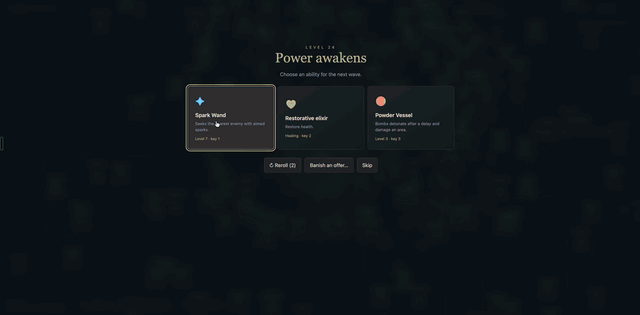

# Bendvy ECS examples

Currently one playable example: **Survivors**, a Vampire Survivors clone built to demonstrate [Bendvy](https://github.com/dearlordylord/bendvy) ECS.

[](https://survivors.dearlordylord.com/)

**[Play in your browser](https://survivors.dearlordylord.com/)** · [Co-op](https://survivors.dearlordylord.com/coop.html) · [Source and controls](examples/survivors/README.md)

## The example

Combat, movement, pickups and progression run in Bend. The example exercises typed components, ECS queries, independent actors and entity lifecycles. Native play uses Bend for rendering, input and audio too; the browser version uses browser presentation and input adapters around the compiled Bend simulation.

Both consume the published **BendHub distribution** of Bendvy. No local Bendvy checkout or copied ECS source is required. The imports and audited compiler/package pins are recorded in [bendhub-dependencies.json](bendhub-dependencies.json).

## Run locally

Install the Bend version declared in the [dependency manifest](bendhub-dependencies.json) and a C compiler. On macOS, install Apple's Command Line Tools with `xcode-select --install`, then:

```sh
git clone https://github.com/dearlordylord/bendvy-ecs-examples.git
cd bendvy-ecs-examples
./examples/survivors/run.command
```

The launcher builds the current local sources and opens a native window; no Node.js or browser is needed. Use `git pull` to receive updates. See the [example guide](examples/survivors/README.md) for Linux requirements, browser development, controls and save locations.

## Development and research

- [Validation and platform limits](examples/survivors/VALIDATION.md) · [Bend laws and offscreen spawning](examples/survivors/spawn-policy/README.md)
- [Balance notes](examples/survivors/BALANCE.md) · [Co-op architecture](examples/survivors/COOP.md)
- [Native bots and simulations](tools/survivors-bot/README.md) · [Native-step measurements](research/native-step-results.md)
- [Game-selection research](research/ecs-game-selection/README.md) · [Bend parallelism](research/bend-parallel-bots.md) · [Metal experiment](research/metal-game-boundary.md)

Check the published dependency and run the example's checks from this repository root:

```sh
python3 scripts/check-dependencies.py --registry
bash examples/survivors/check.sh
bash examples/survivors/check-native.sh
```

Check requirements and the scope of recorded results are described in [validation](examples/survivors/VALIDATION.md). Ordinary gameplay and practical bot runs use CPU; Metal remains a research experiment.

## License

**MIT OR Apache-2.0** — see [LICENSE-MIT](LICENSE-MIT) and [LICENSE-APACHE](LICENSE-APACHE). The example uses its own names and procedural graphics; Vampire Survivors is the gameplay reference.
