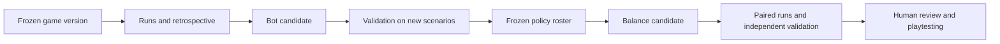

# Plan: Survivors balance, bot set and improver

Date: 2026-10-25. Status: Study and proposed implementation plan. The game balance has not been changed; a new race campaign was not launched. Improver - Codex: Analyzes executions, suggests and verifies code/parameter changes between campaigns. Constant calls to the classifier within mass races are not required.

## What was discovered

1. There is a native Bend → C bot with XP memory and routing. The mass runner is currently only solo, with one controller and two fixed presets. `--profile both` alternates preset by index: this is not a crossed “every seed × every profile” experiment.
2. There is already `party-difficulty.bend`: ordinary spawn budget is multiplied by the number of living connected players, with a ceiling of 500. This is a budget of active slots with a stepped tolerance, and not a fixed frequency of “mobs per second”. New HP and admission also depend on the selected seed player view and personal Curse; this is a separate interaction to test. Details and sources are in [engine audit ](balance-bots-engine-audit.md).
3. The old 100 native races cover 30 game seconds and a different version of the game. They don't test the current early difficulty, full ten minute run, or co-op.
4. A real `canonical-defense/lab` laboratory was found in Jev: real Bend simulation, equal budgets, baseline/A/B/A+B, replay and tuning/held-out division. Her short training results are themselves marked as insufficient qualifications. We transfer methods, not numbers: [local study](balance-bots-local-history.md).
5. [Official online FAQ poncle](https://poncle.games/vs-online-faq) says that enemies do not scale with the number of players. In [local-co-op FAQ](https://poncle.games/coop-faq), restrictions on weapon slots are listed among the balance levers. We have different progression rules, so our `×2` is a testable hypothesis, not a requirement of the original; Direct copying of one coefficient also does not solve the balance.

## Clarified first goal: too many monsters for two

The user separately confirmed that the number of monsters with two players is currently excessive. This is the original design requirement; there is no need to first prove to the user that his perception is wrong, or to build the entire improver before the first co-op relief.

The first narrow experiment changes only the cooperative population premium. Solo, base time curve, enemy HP/damage/speed, XP, weapons and choice pauses remain controls. Example of compared limits for standard mode without Curse/Hyper:

| Odds for two live | With a base limit of 96 | With a base limit of 300 |
| --- | --- | --- |
| Current ×2 | 192 | 500 (cap) |
| Candidate ×1.5 | 144 | 450 |
| Candidate ×1.25 | 120 | 375 |
| Control ×1 | 96 | 300 |

These are the limits of regular active slots, not the already measured numbers of living mobs and not the result of testing. Initial practical candidate - ×1.25; ×1 and ×1.5 are needed as neighboring controls. The final odds are selected after a short comparable run and mobile co-op viewing. Since the coefficient is valid for the entire run, before release you also need a small regression set with a full 10-minute horizon (for example, 2-4 pre-selected seeds with suitable control setups). Early death remains the outcome; if no one reaches the late windows, the late balance remains unchecked. One living player must maintain the same base population limit; for zero, the absence of new ordinary admissions is maintained.

A sufficient first laboratory: one shared `CoopCore`, two fixed controllers, existing information about the enemy population/HP/XP/phase plus short time samples. Full attribution of every damage, four new persona, new RNG and a large optimizer do not block this first step. Maintaining the XP formula does not promise the same XP rate: fewer mobs changes the amount of drops and the safety of collecting them. We measure this mediating effect without compensating for it with an unreported change in XP in the same candidate. Subsequent steps below expand the ongoing review cycle. We carry out a crowd damage experiment only if, after reducing the premium, a separate confirmed problem remains; it is not mixed into the first result.

## What techniques do we take from research?

| Reception | What do we use it for? | What it doesn't install |
| --- | --- | --- |
| Rising, peak and rest phases for [Valve L4D](https://steamcdn-a.akamaihd.net/apps/valve/2009/ai_systems_of_l4d_mike_booth.pdf) | We design a time curve and measure the actual pressure experienced by each player | We do not introduce unsolicited dynamic adjustment of difficulty to the player’s success |
| Designer goals and limited search from [Metagame Autobalancing](https://ieee-cog.org/2020/papers/paper_100.pdf) | We select several parameters for a set of outcomes and styles | A bot's maximum score does not equal a good balance; PvP win rate does not carry over to our PvE |
| Variety of strategies from [MIMIC](https://arxiv.org/html/2510.01635v1) | We save different policies instead of one “smartest” bot | The styles we named are not a measured population of people |
| Memory of attempts and executable skills from [Reflexion](https://arxiv.org/abs/2303.11366), [Voyager](https://arxiv.org/abs/2305.16291) | I'm doing a retrospective and offering a testable controller patch | Model explanation does not prove cause of death or improvement |
| Separate development/test worlds from [Procgen](https://proceedings.mlr.press/v119/cobbe20a.html) | We do not accept a bot that has only learned a set of familiar seeds | One final set does not prove quality in all possible worlds |
| [NIST: ](https://www.itl.nist.gov/div898/handbook/pri/section3/pri332.htm) blocking and factorial experiments | We compare pairs with the same setup and check interactions separately | Thousands of frames of one race - not thousands of independent observations |

Full sources, their limitations and possible tools: [main articles](balance-bots-primary-sources.md), [PLDB, improver and experimental design](balance-bots-pldb-methods.md), [search query entry](balance-bots-pldb-search.json). This is a targeted review of primary sources, not a statement about the single best algorithm available today.

## Two separate cycles

In one comparison, we change either the game or the bot. Semantically neutral extraction of the common kernel follows a separate step with equality checking. After accepting a new game, we check the entire saved bot panel, including previous control versions. Increasing the quality of “your” bot should not become a reason to endlessly increase the difficulty for people.

## Implementation queue and readiness criteria

| Priority | Result | We accept when |
| --- | --- | --- |
| 1 | Minimum playable solo/co-op baseline | One real `CoopCore`, two controller memories, real offers, enemy counts/HP/XP/phase, explicit outcomes and cost pilot |
| 2 | Reduced mob bonus for two living ones | Compared ×2/×1.5/×1.25/×1; solo and other parameters are saved, new seeds and a mobile game confirm the direction |
| 3 | Causal telemetry, multiple policies and retrospective | Damage and healing are distinguishable, different strategies and specific errors are visible; history is saved between launches |
| 4 | The following time curve fixes | On a separate hypothesis, the early window was improved, the crowd/threat growth and late challenge were preserved; the result is not mixed with bot improvement |
| 5 | Regular improver cycle and full runs | Candidates undergo benchmark policies, new contexts, execution budgets and human review; no late game degradation |

### 1. We measure pressure, not just final HP

The native Bend runner accumulates compact indicators of game time: buckets per second, final graphs with windows of 5/15 seconds. The full world of every tick in JSON is not serializable. For rare critical decisions, we leave a detailed context and immediate game outcomes. The scheme includes:

- actual applied damage by sources and its components: contact/enemy projectile, temporary/crowd bonus, stage hazard; separately absorbed/blocked damage, invulnerability, healing and changing max HP;
- living enemies, new admission/spawn, nearby threats and dangerous projectiles; crowd cap and queue of waiting slots; whenever possible, free exit directions as an explicitly designated proxy;
- XP created, physically matched, bonus and remaining; saving XP in piles does not equate to the availability of safe selection;
- level, upgrade moments, individual weapon selections/ranks; We do not pass off the general levels of the cooperative as two independent XP scales;
- death of each player and team, timeout/fuel exhaustion/error, reaching a given horizon and the regular terminal phase;
- pure step and controller decision time, memory, assembly cost separately from execution.

HP after healing is not total damage; kills are not DPS. Bounded horizon - right censoring, not a victory. For this game, phase 4 has its own ending semantics: we do not classify it as an ordinary death only by HP 0. The graphs show the number of those remaining under observation and the survival curve; improving HP only among survivors does not hide the dead.

The first pilot is a small fixed set, for example 4 seeds × 2 initial setup for 120 game seconds, with an external wall time limitation. This is a measurement of the cost and quality of telemetry, not a statistical statement of balance. We choose the size of the mass campaign after the pilot, without promises of “thousands of games per minute.” This baseline-pilot does not select a coefficient yet. Before the first candidate-run, we save a separate experiment manifest with selection criteria: windows of the number/density of mobs, survival milestones, time of the first upgrades, acceptable regression deviations and a rule for working with uncertainty. The numerical boundaries have to be calibrated against the baseline and the desired experience; they are not retroactively derived from the preferred candidate.

### 2. Pressure curve and multiplayer balance module

We propose to select a common pure Bend `BalanceConfig`/pressure policy and expand the existing `party-difficulty.bend` or replace it with a single `multiplayer-balance.bend`. We do not create parallel formulas in the browser, solo and batch runner.

The base curve sets the population/admission budget, composition/HP of enemies, contact components and hazard schedule according to the game tick/stage/mode. The cooperative part obviously receives the number of living/connected ones, the selected personal Curse policy and the rules for future spawning. We first save and measure the semantics of `seed parity`; Curse aggregation by maximum/average is a separate solution and a separate candidate, not a hidden part of the refactoring.

First desired pattern: entry with the ability to put together a starting build → waves of growth and breathing room to return for XP → noticeable tests of the strength of the build → challenging late part. We do not make the entire curve monotonous if there are breaks in it. Specific ranges of survival/damage/pace of levels are first announced based on baseline and human viewing, before searching for coefficients. Starting focus - first 30/60/120/180 seconds; then a real full run of standard mode (36,000 ticks, 10 game minutes). We don’t base a late conclusion on the first 30 seconds we experienced.

For the first diagnosis, we compare the current multiplayer budget `×2` with pre-listed candidates, for example `×1`, `×1.25`, `×1.5`, preserving the remaining rules. This is a suggested search space, not already found good values. If the first correction does not fix the confirmed environmental problem, then a separate 2x2 experiment: baseline, A - softer early budget, B - softer crowd damage bonus, A+B. The four shoulders are needed to see the interaction of pressure and environmental punishment.

The module does not change the HP of existing monsters when a partner dies and does not remove the crowd to improve the metric. We measure separately how dangerous the transition from two living to one is. We will keep the general XP, chest ownership, simultaneous upgrades and the absence of a new revive mechanism until a separate decision on the mechanics is made.

### 3. One real world for two bots

The new native harness uses a common gaming `CoopCore`: connecting a second record to tick 0, two controllers with independent memory, a joint step and servicing each required selection through a real catalog/offer/round. Two solo runs do not replace this scenario.

For a large campaign, a quiet typed path of the general step is needed: a renderer, a full frame JSON and a cosmetic hit journal should not become a mandatory price for each headless tick. The overall movement/hit/reward calculation remains the same. We check compliance with the states of a regular entry on fixed inputs, including natural level-up, death and selection; We don’t copy gameplay into a fast alternative simulator. When checking quiet/ordinary, the coincidence of the final kills/HP is not enough: we compare the canonical observations of players, components of enemies/projectiles and awaiting rewards on the same teams; we save the exact area of ​​this final check. A small pilot can first use the normal path and fix its cost - a separate large quiet refactoring does not have to block the first reduction in the premium. Causal coefficient comparison - `Core2(current)` vs `Core2(candidate)`. Product solo - separate regression control; We do not declare `Core1` a complete copy: the current revive/offers are different. The scenario of one living in a cooperative is checked separately as `Core1`/state after the death of a partner. Mass balance check occurs without a network; browser and mobile checks remain separate integration terms.

Co-op panel: identical policies side by side; XP-assembler + careful; aggressive + cautious; players are far from each other; strong + beginner; one dies or is temporarily inactive. We check the disconnect/return with the current pause semantics, we do not invent the continuation of the game during the network pause. Identical characters and different couples are needed separately. We check different roles/characters in both A/B and B/A permutations: seed-parity view, tie during selection and personal XP bonuses can make the player slot significant. Curse14/Arcana5 also affects earned XP; We fix the initial composition of the pair and separately observe the raw/bonus XP. For each case, the team outcome and the contribution/death/choices of each player are visible, and not just the total kills.

### 4. A set of bots and my retrospective

We save the current `resource-memory-v1` as a control. We add parameterized options: cautious, XP-oriented, aggressive and limited in observation/reaction. The latter uses the visibility and memory of previously seen XP; the limits are simulated by game ticks and separately calibrated based on the person's observed play. Full access to the world remains clearly marked by oracle control, not by the “regular player”. The names of styles in themselves do not prove diversity: we compare trajectories, distance to threats/XP and sequences of decisions.

After a series of races I:

1. I select a repeating failure along the route and separate the controller error from the suspected mechanical problem;
2. I save a minimal scenario and a snapshot of facts: goal, visible alternatives, risk/path estimate, XP position, HP, selected movement/upgrade, policy version;
3. I write down a hypothesis and one patch: for example, hysteresis of holding an XP target, breaking a local deadlock, reserving different clusters with two bots, or evaluating an actually proposed upgrade;
4. I announce in advance the main effect, style limitations and cost of the solution; I fix the game, seed/setup and controls;
5. I execute the candidate and baseline on the development cohort, check the new counterexample and all the old regressions;
6. I accept the new version only after separate verification; I leave the old one in the control roster and archive the rejected candidates with a reason.

The new policy does not receive auto-matching, additional XP, greater attack range, knowledge of undetected objects, or prohibited actions. You can't "improve" a cautious bot by turning it into a kiter like everyone else. Alternatives and upgrade mechanics are taken from Bend; classifier remains an optional, expensive diagnostic arm, not a campaign dependency. The bot's solution must fit within the stated resource budget.

The improver does not have to be neural network learning. We start by changing understandable weights/thresholds and small algorithmic patches based on execution. [Reflexion](https://arxiv.org/abs/2303.11366) supports the idea of ​​retained feedback, but the acceptance here comes from repeated execution. If there is insufficient data, the result of the retrospective is “telemetry is needed / the hypothesis is not confirmed”, and not a made-up reason.

### 5. Comparison protocol and anti-fitting protection

Each manifest line is an explicit tuple: seed, stage, mode, horizon, profile/characters/Arcana/meta, party size, policy IDs, balance config. The candidate and baseline receive the same panel. Source/binary/compiler/BendHub hashes, terminal schema and worker/thread settings are recorded separately. We do not mix different presets into one “medium complexity”.

The working first size after pilot: 32 development seeds, 16 validation and 32 final confirmatory ones, with the number of setup reduced to the feasible budget. This is a suggested initial layout, not proven to have sufficient statistical power. Development is used for searching; validation - to select a candidate; the final cohort is unlocked after being frozen. If its results are used for the next patch, it is marked expended and ceases to be an independent check. The Ledger of use is common to both cycles: a seed opened when improving a bot cannot be renamed “independent” when setting up a game, and vice versa. This rule applies to viewing detailed failures, not just the optimizer.

The same seed does not mean identical encounters after changing actions: the order of RNG calls may diverge. Pairing remains a consideration of initial conditions, but not proof of the causal equality of episodes. We explore coupling and, if necessary, separately design named RNG streams/event keys; We do not disguise the RNG change as a coefficient adjustment.

We show pairwise differences and distributions by seeds, uncertainty intervals, survival milestones and early/late windows separately. We do not declare frames as independent samples. We carry out a targeted search for severe cases separately from the representative cohort: the adversarial seeds found are regressions, and not an assessment of the probability of death of an ordinary player. We don’t throw away unfavorable outcomes/timeouts; a technical failure marks the comparison as incomplete.

A large automatic search is not needed yet. After checking the sensitivity of the metrics, you can add an optional supervisor with a limited list of parameters/number of trials, for example TPE/Optuna. All rules and bot policy remain in Bend. Search has restrictions on early deaths, CPU overload, ignoring XP and zeroing pressure; We select several successful tradeoff candidates for viewing instead of one opaque “fun score”.

### 6. Laws, review and release

Bend laws fix exact solutions: boundaries/rounding of the configuration and absence of overflow; equality of the old/extracted formula with the original config; single-player identity where provided; living-count 0/1/2 and future-spawn transitions; unchanged HP of already created enemies; applied damage components; shared XP/physical collector and unique choices; determinism of policy ties and admissibility of actions. Contracts are drawn up for the actual common callsite and verified by the mutants.

We don’t write the law “the game is fun”, “survival is at least X for all seeds” or “the pressure is always increasing”. Such goals are tested experimentally and by humans. Telemetry should not change the state/outcomes: we compare instrumented/quiet executions on the same commands. Until the new balance is approved, verified network guarantees and off-screen spawn law are maintained.

For each finalist, we look at several pre-selected good, median and bad races; then we play solo and together on phones. We check whether there was an opportunity to assemble a build/return for XP, whether the cause of death is readable, whether there are respites and whether the threat remains in the late game. The touchscreen and the inconvenience of control cannot be deduced from the headless policy.

We accept early game relief only when improving announced outcomes in independent contexts without hidden crowd destruction, late pressure, progression or co-op role of the second player. After this, we update the graphs, manifest and baseline. The build/publish follows the existing fresh-source release process; a research document by itself does not change the public game.

## Independent review of the plan

[The Astra](balance-bots-plan-review.md) review tested the feasibility of the first narrow step and experimental pitfalls. The plan includes mirrored player-slot pairs, a mediating XP effect, a common holdout ledger for both cycles, a Core1/product solo distinction, and a small full regression run before release. This is a plan review, not a confirmation of numerical candidates.

## First concrete implementation cycle

1. Record current configurations and minimum time samples; make a real shared-core cooperative pilot with two existing controllers and solo control.
2. Change only the ordinary population allowance for two living ones: ×2 baseline, candidates ×1.5/×1.25/×1. Choose relief from representative seed comparisons and playing together on phones; Run a small full-horizon regression set before releasing. Don't wait for a complete bot training system.
3. After the first relief, add causal telemetry and a limited observation bot option. A retrospective may open a separate bot experiment on finding XP/exiting the environment.
4. Freeze the updated panel. For individual hypotheses, explore time windows and crowd damage, including interactions, with new confirmatory seeds and full runs.
5. Expand roster/builds and automatic search following a proven measurement basis. At each cycle, I am the author of the candidate being tested, and saved controls and independent review limit the ability to tailor the output to my patch.
